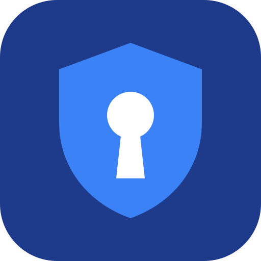
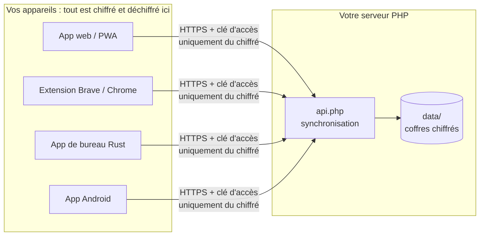

<div align="center">



# BioPass

**Le gestionnaire de mots de passe familial, auto-hébergé, chiffré de bout en bout.**

Un serveur PHP sans base de données · une application web hors ligne · une extension Brave / Chrome ·
une application de bureau native · une application Android avec saisie automatique.

[](LICENSE)

</div>

---

BioPass remplace Bitwarden pour une famille, sur **votre** serveur : chaque membre a son coffre,
chiffré sur ses appareils avant tout envoi. Le serveur ne stocke que des données chiffrées et ne
peut rien lire, même s'il est compromis.

L'installation se résume à **déposer un dossier dans un site PHP existant**. Pas de base de données,
pas de conteneur, pas de modification du serveur web. Sans la clé d'accès, l'adresse répond 404 :
BioPass reste invisible pour les robots et les curieux.

## Sommaire

- [Fonctionnalités](#fonctionnalités)
- [Comment ça marche](#comment-ça-marche)
- [Sécurité](#sécurité)
- [Installation du serveur](#installation-du-serveur)
- [Les applications](#les-applications)
- [Migrer depuis Bitwarden](#migrer-depuis-bitwarden)
- [Administration et sauvegardes](#administration-et-sauvegardes)
- [Développement](#développement)
- [Limites connues](#limites-connues)
- [Licence](#licence)

## Fonctionnalités

| | Web (PWA) | Extension | Bureau | Android |
|---|:-:|:-:|:-:|:-:|
| Coffre chiffré de bout en bout, synchronisé | ✓ | ✓ | ✓ | ✓ |
| Recherche instantanée tolérante aux fautes de frappe | ✓ | ✓ | ✓ | ✓ |
| Lecture hors connexion | ✓ | ✓ | ✓ | ✓ |
| Création et modification d'entrées, historique des mots de passe | ✓ | ✓ | ✓ | ✓ |
| Codes 2FA (TOTP) | ✓ | ✓ | ✓ | ✓ |
| Générateur de mots de passe | ✓ | ✓ | ✓ | ✓ |
| Icônes des sites en haute définition | ✓ | ✓ | ✓ | ✓ |
| Remplissage automatique | | ✓ | | ✓ |
| Proposition d'enregistrer un nouveau mot de passe | | ✓ | | ✓ |
| Déverrouillage par empreinte | | | | ✓ |
| Partage sécurisé par lien (Send) | ✓ | | | |
| Sauvegardes quotidiennes et restauration | ✓ | | | |
| Import Bitwarden, export JSON | ✓ | | | |

Et aussi : dossiers et favoris, champs personnalisés, cartes, identités et clés SSH importées,
verrouillage automatique réglable (ou jamais), déconnexion de tous les appareils, thèmes clair
et sombre.

## Comment ça marche



- **Le serveur est la source de vérité**, mais il ne manipule que du chiffré. Chaque entrée porte une
  révision : les clients ne téléchargent que ce qui a changé, et deux modifications concurrentes
  sont détectées (conflit) au lieu de s'écraser.
- **Les clients partagent la même logique.** La référence est `server/web/assets/core.js`, copiée
  dans l'extension. Les versions Rust et Kotlin sont vérifiées contre des vecteurs de test communs :
  mêmes clés dérivées, même chiffrement, même ordre des résultats de recherche.
- **Les icônes des sites** sont récupérées par le serveur (protégé contre le SSRF) à partir du seul
  nom de domaine, puis normalisées en PNG 128 px par le client et stockées *dans* l'entrée chiffrée,
  avec le reste.

Le protocole complet (cryptographie, API, stockage, algorithme de recherche) est décrit dans
[PROTOCOL.md](PROTOCOL.md).

## Sécurité

| Élément | Choix |
|---|---|
| Dérivation de la clé | PBKDF2-SHA256, 600 000 itérations, puis HKDF → clé d'authentification + clé d'enveloppe |
| Chiffrement | AES-256-GCM, une clé de coffre aléatoire enveloppée par le mot de passe maître |
| Entrées | chiffrées une par une, liées à leur identifiant (données associées) |
| Authentification | le serveur ne reçoit qu'une clé dérivée, stockée hachée (Argon2id) |
| Accès au serveur | clé d'accès secrète dans l'adresse : sans elle, tout répond un 404 identique à nginx |
| Connexions | limitation des tentatives par adresse IP, sessions révocables à distance |

Conséquence assumée : **un mot de passe maître oublié ne peut pas être récupéré**. Ni par vous, ni
par l'administrateur du serveur.

<details>
<summary><b>Comment BioPass reste invisible sans toucher à nginx</b></summary>

Le dossier déployé ne contient **que des fichiers `.php`** :

- `index.php` (application web) et `api.php` (API) sont les seuls points d'entrée, et ils vérifient
  la clé d'accès (`?k=`, en-tête `X-BP-Key` ou cookie).
- Pages, scripts, styles, APK et extension sont regroupés dans `web.php` et `downloads.php`
  (générés, servis depuis la mémoire d'OPcache) et appelés via `index.php?f=…`.
- Tous les autres fichiers, données comprises, commencent par une garde : appelés directement, ils
  répondent le 404 de nginx, à l'octet près.
- Sans clé, `/biopass/` imite la page 404 de votre site (réglage `not_found_page`).

Seule trace inévitable : nginx répond `/biopass` (sans `/` final) par une redirection 301, comme pour
tout dossier existant. Un nom de dossier imprévisible supprime cet indice.

</details>

## Installation du serveur

**Prérequis :** un site PHP 8.1+ en HTTPS (nginx + PHP-FPM, ou Apache), avec l'extension `curl`
pour les icônes. OPcache est recommandé. Pour construire : PHP en ligne de commande, `zip`,
`openssl` et un Chromium (pour signer l'extension).

### 1. Configurer

```sh
git clone https://github.com/fabiochelly/biopass.git && cd biopass
cp server/config.sample.php server/config.php
```

Éditez `server/config.php` ; chaque réglage y est expliqué. L'essentiel :

| Réglage | À mettre |
|---|---|
| `access_key` | un identifiant long et imprévisible : `cat /proc/sys/kernel/random/uuid` |
| `registration_code` | le code que les membres de la famille saisiront pour créer leur compte |
| `public_url` | l'adresse de BioPass sans la clé, ex. `https://example.com/biopass` |
| `not_found_page` | la page 404 de votre site, relevée avec `curl -si https://example.com/nexiste-pas/` |

### 2. Construire et déployer

```sh
tools/build-server.sh
```

Ce script génère `server/web.php` et `server/downloads.php` (application web, extension signée,
APK si elle est construite). Il faut ensuite envoyer le contenu de `server/` **sans `web/` ni
`data/`** dans un sous-dossier de votre site, par exemple `/var/www/example/biopass/`.

Pour automatiser l'envoi, copiez `deploy.conf.sample` en `deploy.conf`. `build-server.sh` enverra
alors tout seul le serveur par `rsync`, sans jamais toucher aux données, et pourra mettre à jour
l'application sur un téléphone Android branché en USB.

Le dossier `data/` est créé automatiquement : PHP doit pouvoir écrire dans le dossier de BioPass.
Sinon, une seule fois : `mkdir data && sudo chown www-data: data` (utilisateur du pool PHP-FPM).

### 3. Vérifier

```sh
curl -si https://example.com/biopass/ | head -3           # même 404 que n'importe quel dossier inexistant
curl -si "https://example.com/biopass/?k=<clé>" | head -1 # 200
```

Si `/biopass/?k=…` ne répond pas (directive `index` de nginx sans `index.php`), utilisez
`https://example.com/biopass/index.php?k=…` : tout fonctionne de la même façon.

### 4. Créer les comptes

Chaque membre de la famille ouvre l'adresse avec la clé, clique sur **Créer un compte** et saisit le
code d'inscription. Une fois tous les comptes créés, videz `registration_code` dans `config.php`
pour fermer les inscriptions.

## Les applications

Toutes demandent la même chose au premier lancement : **l'adresse complète avec la clé**, que le site
affiche dans le menu ☰ → **Applications et extension**, puis l'identifiant et le mot de passe
maître. La clé n'est plus jamais affichée ensuite.

### Application web (PWA)

L'adresse du serveur, dans n'importe quel navigateur. Sur mobile, « Ajouter à l'écran d'accueil »
en fait une application plein écran qui fonctionne **hors connexion**, en lecture seule. Elle
propose aussi les partages, les sauvegardes, l'import et l'export.

**Send — partager un secret par lien.** Le contenu est chiffré dans le navigateur. La clé de
déchiffrement reste dans la partie `#…` du lien, que le navigateur n'envoie jamais au serveur.
Code PIN optionnel (le lien est détruit après 5 essais faux), nombre de consultations et durée de
validité limités, révocation à tout moment. Le destinataire n'a besoin ni de compte ni de la clé
d'accès.

### Extension Brave / Chrome

- **Menu sous les champs de connexion** : cliquez sur le compte, ou tapez le début de l'identifiant
  pour filtrer.
- **Ctrl+Espace** remplit le dernier compte utilisé sur le site ; un nouvel appui passe au compte
  suivant.
- **Ctrl+Maj+G** copie un mot de passe généré.
- **Clic droit dans un champ** : « Remplir avec BioPass » ou « Générer un mot de passe ici ».
- **Après une connexion**, un bandeau propose d'enregistrer le nouveau mot de passe ou de mettre à
  jour l'ancien.
- **Remplissage cloisonné** : un mot de passe n'est transmis qu'à une page, ou une iframe, du domaine
  de l'entrée.

Installation, au choix (menu ☰ → **Applications et extension** du site) :

- **Linux, avec mises à jour automatiques** : le script `install-brave.sh` fourni par le site déclare
  l'extension signée par une politique de Brave, Chrome ou Chromium (sudo requis). Le navigateur
  l'installe et la met à jour tout seul.
- **Chrome Web Store** : publication « non répertoriée », voir
  [tools/webstore/README.md](tools/webstore/README.md).
- **Manuelle** : téléchargez le zip, puis `brave://extensions` → mode développeur → « Charger
  l'extension non empaquetée ».

> **Touche Compose et macros clavier (keyd…)** : Brave sous Wayland ne les transmet pas aux bulles
> d'extension. Activez « Ouvrir BioPass dans une fenêtre » dans les réglages de l'extension.

### Application de bureau (Linux, Windows, macOS)

Client natif en Rust (egui) : un binaire unique, ouverture instantanée et recherche immédiate.
Il est pensé pour retrouver et copier un identifiant au clavier en une seconde.

```sh
cd desktop && cargo build --release
packaging/linux/install.sh      # Linux : lanceur et icônes pour l'utilisateur courant, sans sudo
```

Raccourcis, cache et tests : [desktop/README.md](desktop/README.md).

### Application Android

Service de **saisie automatique** Android, avec suggestions dans la barre du clavier, pour les
applications comme pour les navigateurs. Elle propose aussi le déverrouillage par empreinte, le
coffre hors ligne et l'enregistrement des nouveaux mots de passe. APK d'environ 230 Ko, Android 9
minimum.

```sh
cd android && ./build.sh        # compilation dans Docker uniquement → dist/biopass.apk
```

L'APK est ensuite proposée en téléchargement par le site. Installation, réglage de Chrome et Brave,
et fonctionnement : [android/README.md](android/README.md).

## Migrer depuis Bitwarden

1. Bitwarden → Outils → **Exporter le coffre** → format **`.json`** (pas « .json chiffré »).
2. Application web BioPass → menu ☰ → **Importer depuis Bitwarden**. Le fichier est lu et chiffré
   **dans le navigateur** ; seul le résultat chiffré part au serveur.
3. **Supprimez le fichier d'export**, qui contient tout en clair, y compris de la corbeille.

Sont repris : identifiants, sites, codes 2FA, notes, champs personnalisés, favoris, dossiers (ou
collections), historique des mots de passe, cartes, identités et clés SSH. Les passkeys ne peuvent
pas être exportées par Bitwarden : une note le signale sur l'entrée. Un nouvel import ignore les
doublons.

## Administration et sauvegardes

Tout est dans `data/` : un fichier par compte et par coffre, plus les instantanés et les partages.
**Sauvegarder ce dossier suffit.**

- **Instantanés quotidiens** de chaque coffre, conservés 30 jours (`backup_days`). Chacun peut
  comparer un instantané à son coffre actuel et restaurer des entrées depuis le site (menu ☰ →
  Sauvegardes).
- **En ligne de commande**, sur le serveur :

```sh
php bin/admin.php list             # comptes et nombre d'entrées
php bin/admin.php revoke <nom>     # déconnecte tous les appareils d'un compte
php bin/admin.php delete <nom>     # supprime un compte
```

## Développement

```
server/            serveur PHP (points d'entrée, src/) et application web (web/)
  web/assets/      core.js = référence du protocole client, partagée avec l'extension
extension/         extension Manifest V3 (lib/ = copie de core.js et icons.js)
desktop/           application de bureau Rust + egui
android/           application Android (Kotlin, sans framework), compilée dans Docker
tools/             build, déploiement, tests, vecteurs de test communs, pages de test
PROTOCOL.md        protocole et formats, à respecter par tous les clients
```

```sh
php -S 127.0.0.1:8000 -t server   # développement local : sert directement server/web/ (sans build)
tools/sync-core.sh                # après une modification de core.js ou icons.js
tools/test-all.sh                 # serveur, sauvegardes, Send, extension (Chromium headless), 404
(cd desktop && cargo test)        # vecteurs de chiffrement et de recherche, côté Rust
(cd android && ./build.sh test)   # les mêmes vecteurs, côté Kotlin
```

- `tools/test-vectors.json` et `tools/search-vectors.json` garantissent que JavaScript, Rust et
  Kotlin dérivent les mêmes clés et classent les résultats de recherche à l'identique.
- `tools/test-sites/` rassemble des pages de connexion piégeuses (deux étapes, shadow DOM, iframe
  d'un autre domaine, champs à la React) ; ajoutez-y tout site qui pose problème à l'extension.

## Limites connues

- Pas de partage d'entrées entre les membres de la famille : un coffre par personne. Send permet
  d'envoyer ponctuellement un secret.
- Hors connexion, les coffres sont consultables mais pas modifiables : le serveur reste la source
  de vérité.
- Les passkeys ne sont pas gérées.

## Licence

[MIT](LICENSE) : utilisez, modifiez et redistribuez BioPass librement, y compris dans un projet
commercial, en conservant la mention de copyright. Le logiciel est fourni tel quel, sans garantie.
